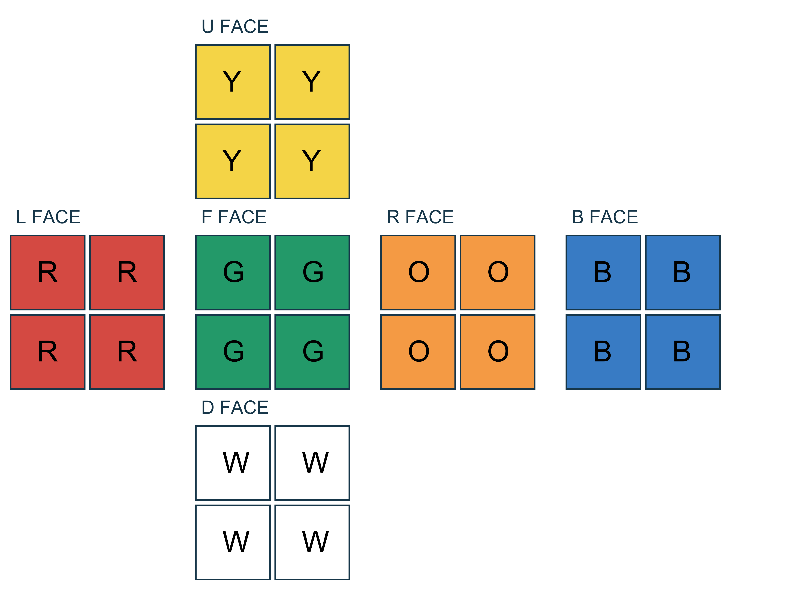
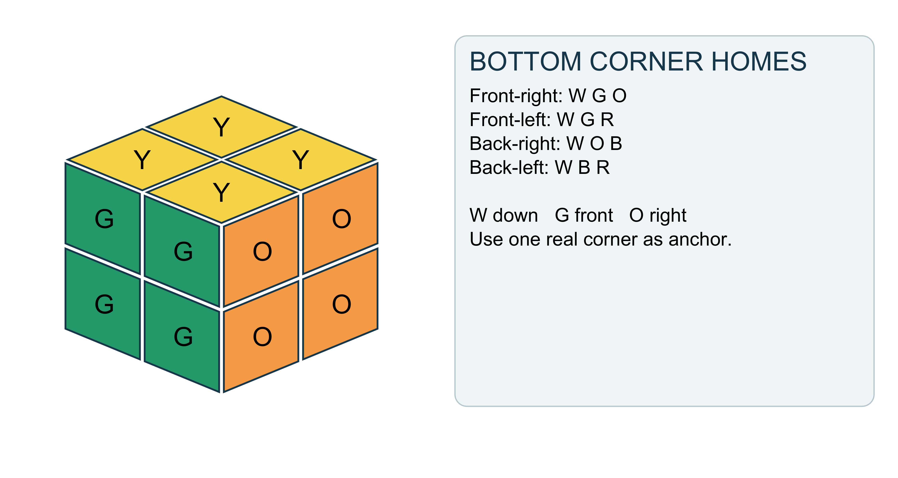
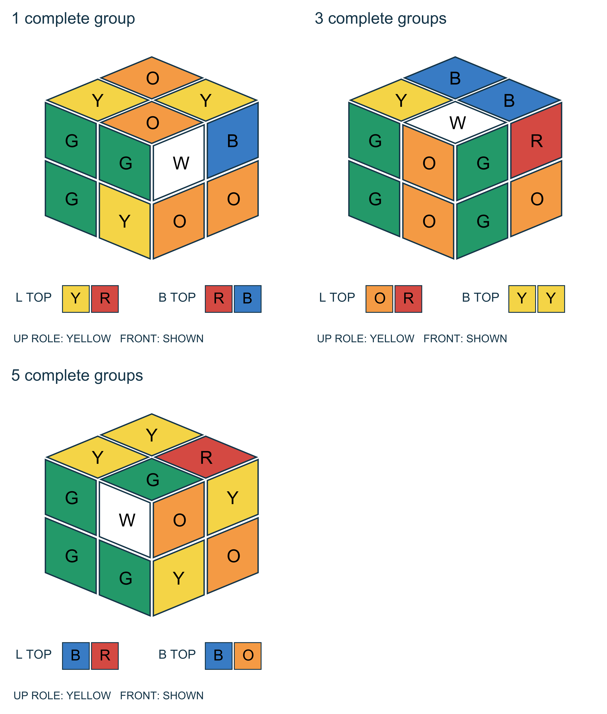
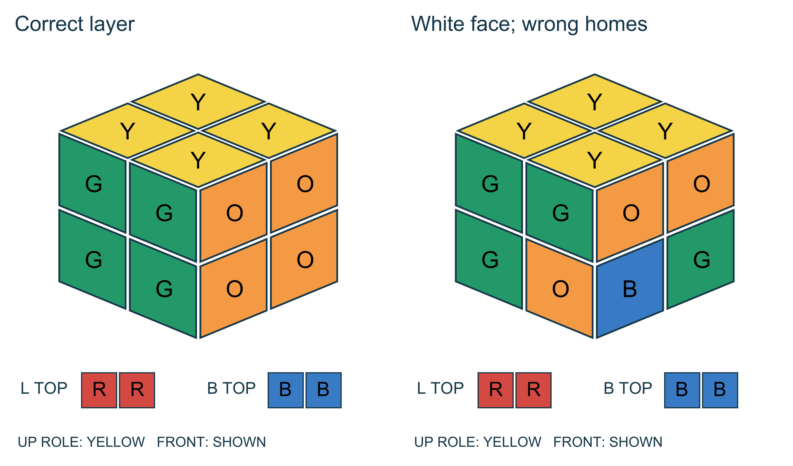
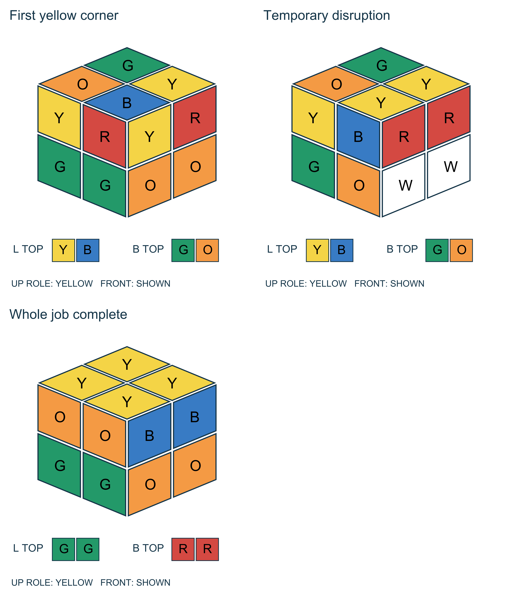
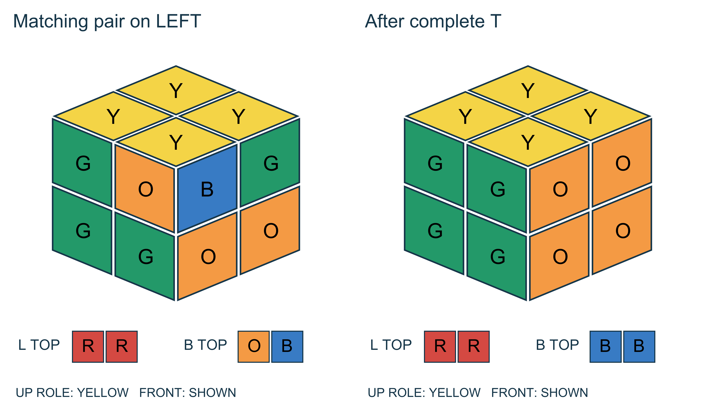
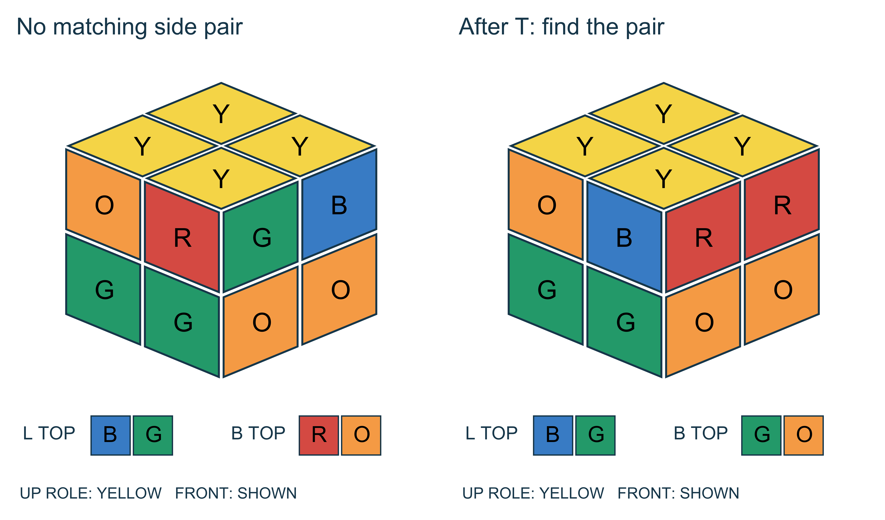
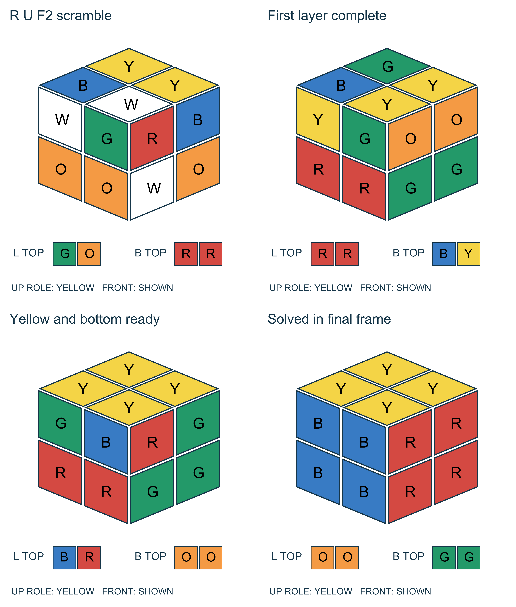

# Solve your first 2×2

> John Briggs · How to Master the Cube companion · Updated November 25, 2026. Optional learning beyond the book’s self-contained 3×3 courses. Model checks do not establish physical comfort or learner comprehension.

Read [notation and grip](notation.md) first if these move names are unfamiliar. You need only this lesson and a 2×2 to follow the route; Python and the printed book are optional.

## Eight corners and a fresh start

Pick up a 2×2 and look for its centers. There are none on the outside. Look for an edge with two colors. Every visible piece is a corner with three colors. You have eight corners to place and turn correctly.

The missing pieces make the puzzle a useful next lesson, but not a puzzle that solves itself. On a 3×3, the center colors tell you where a corner belongs. On a 2×2, you must establish that color frame yourself and keep track of it. What transfers is the thinking: name a piece, find its home, preserve completed work and check the result.

This is a complete beginner route using familiar move groups. It is a learning method rather than a promise of fast competition times. J Perm's beginner tutorial offers another route; follow each guide's own grip and complete sequence rather than combining fragments. [S21]

Use this notation: U top, D bottom, R right, L left, F front and B back. Clockwise means looking straight at the face being turned. For D, imagine looking up at the bottom face. A prime mark reverses the turn; 2 means a half turn. Keep the chosen front fixed unless the instruction says to turn the whole puzzle.

## Establish your color frame with one corner

Our examples use white opposite yellow, green opposite blue and orange opposite red. This is the common modern scheme: with white down and green front, orange is right and red is left. Your puzzle may use different colors or a different arrangement. Do not force a diagram's color names onto a different scheme. One actual corner supplies three neighboring face colors; a solved reference or the manufacturer's color scheme can establish the remaining opposites if you need help.

Find the white-green-orange corner for this scheme. Turn the whole puzzle in your hands until that corner is at bottom-front-right, with white pointing down, green toward you and orange to your right. This is a change of grip, not a face-turn algorithm. That corner becomes your anchor. If your cube uses another scheme, choose the corner that can show white down, green front and its third color right. Use that third color as your right-face color throughout; never exchange R and L in the moves.

The faces now have chosen roles: white down, yellow up, green front, blue back, orange right and red left. These are remembered roles, not hidden stickers you can see. When you turn the whole puzzle around the vertical axis, front and right change together; white stays down. When you turn only U, the side frame stays where it was.

Before turning, point to where the white-green-red corner belongs. Its home is bottom-front-left. Point to where white-orange-blue belongs: bottom-back-right. If that distinction is uncertain, pause here. Identifying homes is more useful than racing into a sequence.

## Build a layer, not just a white face

Your first goal is four white stickers underneath and a matching bottom pair on every side. A solid white face can still contain corners in the wrong homes. Check the side pairs as well.

Choose an unfinished bottom home. Turn the whole cube around its vertical axis until that home is at bottom-front-right. Name the two side colors of that home using the anchor and completed side pairs. Find the white corner containing those two colors.

If the corner is in the top layer, turn U until it is at top-front-right, directly above its home. Its white sticker may face up, front or right. Keep this front fixed and repeat the complete insertion group:

Moves R U R′ U′

Check the bottom-front-right corner after each complete group. Stop when its three colors fit the chosen home. From these prepared starting twists, it takes one, three or five complete groups. Do not add U adjustments between repetitions. Finish the final U′ even if the corner seems to arrive earlier.

The four-move group above works here, with a corner-only check: there are no centers to compare with. Use the remembered color frame and the neighboring corners already placed correctly. Other finished bottom corners should be restored after each complete insertion job.

## Rescue a corner trapped underneath

What if the white corner you need is in the bottom layer but in the wrong home, or twisted in its home? Turn the whole cube, keeping white down, until that wrong location is bottom-front-right. Do one complete R U R′ U′ group to lift the occupant into the top.

Now find its true home. Turn the whole cube to put that home at bottom-front-right, align the target above it with U and use the insertion routine. Do not try to repair a corner by turning one physical piece in its socket.

Keep the anchor and completed pieces in mind while you change grip. A whole-cube turn changes the names of your current front and right colors. It does not change which three colors identify the passenger. Say those colors aloud if you start losing track.

## Check the entire first layer

Look underneath: all four stickers are white. Look around the sides: each bottom pair has one color, and the pairs follow the color frame you established. If white is complete but one side has two different colors, at least one corner needs a different home. Return to the trapped-corner step rather than continuing with a false checkpoint.

## Turn the yellow stickers up

Read this whole stage before beginning. You will temporarily disturb the white layer. Its restoration depends on finishing the entire orientation job. Keep white down and one front fixed throughout this stage. Between corners, turn only U. Do not rotate the whole cube to reach a different corner.

Find a top corner whose yellow sticker is not pointing upward. Turn only U to bring that corner to top-front-right. Repeat this complete group until the working corner's yellow sticker points up:

Moves R′ D′ R D

A corner needing orientation takes two or four complete groups in this prepared routine. Finish the D at the end of each group. Then use U to bring another incorrectly oriented corner to the same workplace. Skip corners that already have yellow up.

During this stage, judge the working yellow sticker after complete groups. Do not stop to rebuild the disturbed white layer between corners. Continue until all four yellow stickers face up. Then check that the white layer and its side pairs have returned. The top side colors may still be in the wrong order; the next stage addresses that.

If the bottom has not returned after the complete job, a group, grip or U adjustment was probably missed. If you know the exact moves you made, undo them in reverse order. If you do not, rebuild the first layer and begin the orientation stage again slowly. That is a controlled recovery, not a reason to force a corner.

## Put the top corners in order

First check whether a simple U, U2 or U′ aligns the top side colors with the bottom side pairs. If so, you are finished. Do not add an algorithm to an already solved puzzle.

Otherwise look around the four top side pairs. A matching pair means the two top stickers on one side have the same color. Some people call these headlights. It does not mean two yellow stickers on top, and it does not require that the pair already matches the bottom color beneath it.

If there is a matching pair, turn the whole cube around the vertical axis to put that pair on the left. Keep white down. Use this full corner-swap sequence in that grip:

Moves R U R′ U′ R′ F R2 U′ R′ U′ R U R′ F′

This sequence is often called T in 3×3 last-layer solving. On the 2×2, its corner effect exchanges the two top corners on the right and preserves the left pair. There are no edge pieces to finish afterward. Complete the whole sequence, then turn only U as needed to align the four side faces.

If no side has a matching top pair, do the same T sequence once in any chosen front grip with white down. Then look again. You will have a matching pair to place on the left. Perform the sequence again from that new grip and finish with U alignment. Looking for the pair between the two applications is part of the method; repeating blindly in the original grip is not the instruction.

## A complete worked journey

Start solved with yellow up and green front. Scramble with R U F2. These are practice setup moves, not something to add to a cube that is already scrambled. Because you started solved in the stated grip, you already know the color frame for this exercise; do not regrip the anchor before following the trace. The optional practice file reproduces the complete route and its intermediate states. Run python3 examples/pocket_practice.py --scramble "R U F2" from the repository root to print the same steps.

Follow the printed trace table below this lesson one row at a time. Each row identifies a decision as well as moves. Rows marked y turn the whole cube as if making a U turn with every layer together; keep white down. R, U, D and F turn only the named face. An apostrophe reverses the named turn, and 2 means a half turn.

Cover the next row before deciding what it should accomplish. When the first layer is complete, point to all four matching bottom side pairs. When orientation is complete, show both the yellow face and restored bottom. At the end, inspect all six faces. A result that merely resembles the last picture is not the final check.

| Step | Decision or job | Moves |
| --- | --- | --- |
| 1 | eject | `R U R' U'` |
| 2 | insert | `R U R' U'` |
| 3 | choose home | `y` |
| 4 | place above home | `U` |
| 5 | place above home | `U` |
| 6 | insert | `R U R' U'` |
| 7 | choose home | `y` |
| 8 | choose home | `y` |
| 9 | insert | `R U R' U'` |
| 10 | next yellow corner | `U` |
| 11 | next yellow corner | `U` |
| 12 | orient | `R' D' R D` |
| 13 | orient | `R' D' R D` |
| 14 | orient | `R' D' R D` |
| 15 | orient | `R' D' R D` |
| 16 | next yellow corner | `U` |
| 17 | orient | `R' D' R D` |
| 18 | orient | `R' D' R D` |
| 19 | matching pair to left | `y` |
| 20 | matching pair to left | `y` |
| 21 | matching pair to left | `y` |
| 22 | swap the other two corners | `R U R' U' R' F R2 U' R' U' R U R' F'` |

## Practise with less help

For a partly completed task, start solved and apply the inverse of the insertion group: U R U′ R′. The desired white-green-orange corner is waiting above its home. Predict the complete group that restores it. Answer: R U R′ U′. Test the round trip, then explain which bottom corner was the working location.

For an independent task, start solved and apply the T sequence once. Keep yellow up and green front. Find a matching top side pair, choose the proper grip and finish the puzzle. The move letters alone are not the answer: you must explain why the matching pair belongs on the left. Finally try an ordinary scramble and use the decision card below whenever you lose your place.

| What you see | Your next useful action |
| --- | --- |
| No clear color frame | Re-establish the anchor and name its three face roles |
| White corner trapped below | Eject it, identify its home and insert it from above |
| White face solid but side pairs mixed | Repair corner homes before beginning yellow |
| White disturbed partway through yellow orientation | Keep the fixed front and finish all yellow corners |
| Yellow up, bottom restored, side colors out of order | Check U alignment, then look for a matching top side pair |
| Matching top side pair | Put it left; do T; finish U alignment |
| No matching top side pair | Do T once, find the new pair, put it left and continue |
| Six uniform faces | Stop and enjoy the result |

There is no requirement to learn a second puzzle quickly. The useful achievement is recognizing what transferred and what required a new explanation. You carried corner identity, insertion, temporary disruption and checkpoints into a smaller mechanism. You also learned to supply a color frame that the 3×3 centers used to show you.

## Two four-move groups with different checks

| Job | Group and stopping rule |
| --- | --- |
| Insert a white corner | R U R′ U′; repeat at its prepared home until that corner fits all three colors |
| Turn yellow corners up | R′ D′ R D; finish the stated corner-by-corner procedure before expecting the whole lower layer back |

The final U′ in insertion and the final D in twisting belong to their groups. Do not omit them because a sticker looks right early. During twisting, the front stays fixed while U brings another corner to the workplace. The three-move triggers and Sune setup in the 3×3 first-solve course are different procedures. Use this lesson’s setup and stopping rules.

## Sources and further learning

[S21]: https://jperm.net/2x2

J Perm’s [beginner 2×2 tutorial](https://jperm.net/2x2) is an optional comparison route. This companion’s prose, diagram layouts and deterministic checked route are original project work. Follow each method’s entire setup and finish rather than combining fragments.
