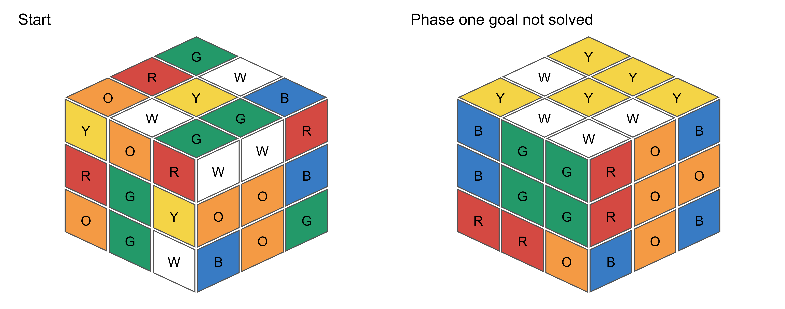
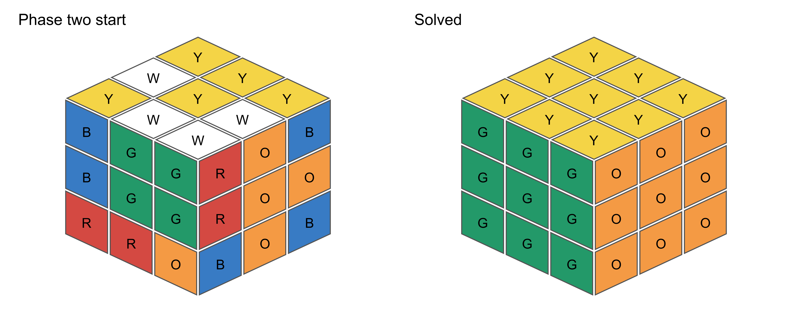

# Solving the cube in code

> John Briggs · How to Master the Cube companion · Updated November 25, 2026. Optional learning beyond the book’s self-contained 3×3 courses. Model checks do not establish physical comfort or learner comprehension.

Start with [notation and grip](notation.md). Runnable commands use Python 3.10 or later, the standard library, and files in this repository. No book, third-party package or API key is required.

```sh
python3 examples/solve_cube.py --scramble "R U F2"
python3 -m unittest discover -s tests -v
```

A human learns to recognize useful shapes. A computer can instead represent a position, generate its legal next positions, and search for a path to a goal. Both approaches need a reliable description of what changed. A search that misunderstands one turn can confidently return a sequence that does not solve the physical cube.

This lesson builds the logic in layers. You will first describe the cube as data, then test moves, validate an entered position, explore search, and understand why practical solvers divide the task. The accompanying program is an educational bounded solver: it stops at limits you choose. Its search method is called Iterative Deepening A-star, or IDA*, explained below. It solves the short examples and verifies its output, but its simple estimate of remaining work does not make it a practical fast solver for arbitrary long scrambles. The two-phase section explains the architecture of a stronger production solver; that production backend is not implemented here.

## How to read this lesson

You can follow the ideas without already writing software. Treat a state as a written record of the cube, a move as an instruction that updates it, and a search as trying possible routes until one reaches solved. A node is one position being considered; a node budget limits how many the program examines.

The indented examples are pseudocode: instructions written to explain the logic, not lines you can paste directly into Python. Python is the programming language used by the downloadable runnable examples. Read one instruction, say what it changes and check the small example before reading the next.

## Start with a precise promise

A solver accepts a legal cube position in a declared reference frame and returns a sequence of allowed moves that reaches the solved state. It should replay its own answer before reporting success. If its search runs out of time or nodes, it must say that the search is incomplete. It must not call the cube impossible merely because it did not find a solution.

We will count a quarter turn, its inverse, and a half turn as one move each. This is the half-turn metric, also called the face-turn metric in this context. Thus R2 costs one search step, although a beginner may perform it as two quarter-turn clicks. There are 18 allowed moves: three amounts for each of the six outside faces. Whole-cube rotations are viewpoint changes and are excluded from this search’s move set.

Keep that cost rule beside every statement about shortest solutions. A result that is shortest under this rule is not necessarily the easiest human sequence, and it is not a claim about another metric.

## Describe pieces rather than a photograph

One representation stores the 54 stickers. Each sticker has a position and the direction its face points. Our diagram engine uses this representation, so that an illustration can be generated from exactly the same legal state used in a check.

A second representation stores the eight corners and twelve edges. For each group it records which piece occupies each location and which way it faces. This makes search states compact, immutable, and easy to compare. Immutable means a stored state is not changed in place: a move creates a new record, keeping the old one available for checking. An array is an ordered list; an index is a numbered position in that list. Here numbering begins at zero.

| Array | What its entries mean | Length |
| --- | --- | --- |
| cp: corner permutation | Which corner occupies each corner location | 8 |
| co: corner orientation | The cyclic orientation of the corner at each location | 8 |
| ep: edge permutation | Which edge occupies each edge location | 12 |
| eo: edge orientation | Whether each edge is flipped relative to its ordered local frame | 12 |

An address and a piece ID are different. If cp[0] is 3, corner number 3 is now at address 0. The number does not mean it is twisted three times. Its facing is stored in co[0].

In the accompanying program the corner addresses are URF, UFL, ULB, UBR, DFR, DLF, DBL, and DRB. The edge addresses are UR, UF, UL, UB, DR, DF, DL, DB, FR, FL, BL, and BR. A letter here names a face, not a sticker’s printed color. Once you choose the six centers, those face labels supply the reference frame.

Corner order also defines orientation. The three letters at each corner form a cyclic order. Orientation zero, one, or two says where its U or D reference color appears within that ordered frame. Edge orientation is zero when its ordered colors match its piece’s ordered reference, and one for the reversed order. Other programs can use different conventions. Their move tables must match their convention; copying an orientation array between conventions is not valid.

## A turn is a table you can test

A right turn always carries the same addresses around the same routes. The colors currently occupying those addresses do not change the route. That lets us precompute each move as a small table.

Our implementation derives its cubie tables from the independent sticker-coordinate model. For a move, the table says which old address supplies each new address and what orientation adjustment accompanies that transfer. This avoids manually typing a second set of turn diagrams and hoping they agree.

```text
APPLY_MOVE(state, table):
    for each corner address i:
        source = table.cp[i]
        next.cp[i] = state.cp[source]
        next.co[i] = (state.co[source] + table.co[i]) mod 3
    for each edge address i:
        source = table.ep[i]
        next.ep[i] = state.ep[source]
        next.eo[i] = state.eo[source] XOR table.eo[i]
    return next
```

In this pseudocode, mod means the remainder after division. XOR flips a 0/1 edge-facing value when the move flips that edge, and leaves it alone otherwise. For example, 0 XOR 1 is 1; 1 XOR 1 returns to 0. Read source carefully. A common error is to store a source-to-destination table but use it as a destination-to-source table. Either convention can work; mixing them reverses the effect. The program’s table and update rule above use the latter convention.

Test a move before testing a whole solver. R four times must restore the original state. R followed by R′ must cancel. A half turn repeated twice must cancel. Then check an independently stated physical path: a front-right middle edge goes to upper-right after R. Finally compare the sticker and cubie models through many legal move sequences. Agreement on only an algorithm and its inverse is weaker evidence: the same error can cancel itself.

## Reject bad input before searching

Nine stickers of each color are necessary, but not sufficient. It is possible to enter nine of each color while duplicating an edge, reflecting a corner, or describing an impossible twist.

The program first identifies every cubie from its ordered colors. It checks that each expected corner and edge occurs exactly once. It then checks three constraints in the chosen orientation convention:

1. The eight corner orientations add to zero modulo three.
2. The twelve edge orientations add to zero modulo two.
3. Corner and edge permutation parity agree.

Modulo means the remainder after division. A corner total of three has remainder zero; a total of one does not. The edge rule excludes a lone flipped edge on an otherwise solved cube. The parity rule excludes swapping only two edges while everything else remains solved. Together with proper cubie identities and orientations, these checks characterize reachable states with the centers fixed.

Parity can be computed by counting inversions in a permutation: how many earlier entries are larger than a later entry. Only whether that count is even or odd matters here. This is a check on the entered arrangement, not a request for the reader to perform a special parity algorithm.

```text
VALIDATE(cube):
    require each corner ID appears exactly once
    require each edge ID appears exactly once
    require every corner orientation is 0, 1, or 2
    require every edge orientation is 0 or 1
    require sum(cube.co) mod 3 == 0
    require sum(cube.eo) mod 2 == 0
    require parity(cube.cp) == parity(cube.ep)
    return LEGAL
```

If input fails, identify the specific check for the user. “Corner colors do not describe a known piece” is more useful than “solver failed.” If input passes but the node budget runs out, keep those messages separate: the state is legal and the search is incomplete.

## See solving as a graph

Imagine each legal cube state as a point. A move is an arrow to another point. The goal is to find a path from the entered point to the solved point. Several different move sequences can reach the same state. R R′ returns immediately to its starting point, so a tree of written sequences contains repeated graph states.

Breadth-first search, or BFS, explores all positions one move away, then two moves away, and so on. With unit move costs, the first time it reaches the goal it has found a shortest path. A queue controls this order: like a line at a counter, the first position added is the first taken out. A visited set is a record of positions already examined, preventing repeated work. Each parent entry remembers which position led to the next, so the program can reconstruct the moves.

```text
BFS(start):
    queue = [start]
    parent[start] = NONE
    while queue is not empty:
        state = remove_front(queue)
        if state is solved:
            return reconstruct_moves(parent, state)
        for move in ALL_18_MOVES:
            child = APPLY_MOVE(state, move)
            if child not in parent:
                parent[child] = (state, move)
                add_to_back(queue, child)
    return NO_PATH
```

The growing queue is the problem for a full cube. Eighteen choices repeated ten times give 18 to the tenth raw sequences, before accounting for duplicates and useful pruning. That is not the number of distinct depth-ten cube states; it illustrates how quickly naive sequence enumeration grows.

BFS is still an excellent teacher and test oracle for shallow cases. Our tests enumerate shallow states with BFS and compare the educational solver’s returned lengths. A small independently checked problem is more useful than an unverified claim that a program handles every scramble efficiently.

## Use a lower bound instead of a guess

A heuristic estimates how much work remains. For shortest-path guarantees, an admissible heuristic never overestimates the true remaining cost. It may be too low. A weak but honest lower bound can be improved later without changing what success means.

One outside face turn touches at most four corners and four edges. If seven edges occupy wrong addresses, at least two face turns are needed to put all of them home: one turn cannot directly affect seven different edges. The same argument gives bounds from misplaced corners and from nonzero orientations. Take the largest of these bounds.

```text
LOWER_BOUND(cube):
    a = ceiling(number of misplaced corners / 4)
    b = ceiling(number of misplaced edges / 4)
    c = ceiling(number of nonzero corner orientations / 4)
    d = ceiling(number of flipped edges / 4)
    return max(a, b, c, d)
```

Do not add those four numbers. One turn can improve corner position, edge position, and orientation at the same time. Adding overlapping work can overestimate the real cost and destroy the shortest-solution guarantee. The maximum is safe because the full solution must be at least as long as each individual lower bound.

This simple heuristic is deliberately weak. It helps make the program understandable, not competitive with a mature cube solver. For deeply scrambled cubes, large databases and specialized coordinates make an enormous difference.

## Search with IDA star

IDA* stands for Iterative Deepening A-star. Depth-first search follows one possible route farther before coming back to try another. Iterative deepening repeats the search with a larger allowance; A-star uses the moves already spent plus an estimate of those still needed. Here the cost threshold is that allowance. IDA* repeatedly performs a depth-first search under a cost threshold. At a state, g is the number of moves already used and h is the lower bound remaining. If g + h exceeds the current threshold, that branch cannot supply a solution within the threshold and is postponed.

The first threshold is h at the start. When a pass finds no solution, the next threshold is the smallest g + h that exceeded the previous one. A successful pass produces a shortest solution under the stated move costs, provided the heuristic is admissible and the pruning has not removed every optimal route.

```text
IDA_STAR(start, depth_limit, node_budget):
    VALIDATE(start)
    bound = LOWER_BOUND(start)
    path = empty list
    while bound <= depth_limit:
        result = VISIT(start, 0, bound, NONE, path)
        if result is FOUND(solution): return solution
        if result is BUDGET_EXHAUSTED: return INCOMPLETE
        if result.next_bound == infinity: return NO_PATH
        bound = result.next_bound
    return DEPTH_LIMIT
```

A resource budget must apply across passes, rather than silently resetting on each threshold. The implementation counts expanded nodes across the entire call. The result distinguishes solved, node-budget exhaustion, and a user-selected depth limit.

A recursive instruction calls the same procedure on a smaller next task: here, visit the next position using one more move. When that attempt finishes, return to the previous position and try another turn. Pruning means skipping a route for a stated reason, such as an immediate return to the same position.

## Read the recursive step

The following is language-neutral pseudocode. FOUND carries a copy of the successful move list. The path-state set contains only ancestors of the current branch and is updated when entering and leaving a child.

```text
VISIT(state, g, bound, last_face, path):
    f = g + LOWER_BOUND(state)
    if f > bound: return NEXT_BOUND(f)
    if state is solved: return FOUND(copy(path))
    if global node budget is exhausted:
        return BUDGET_EXHAUSTED
    count one expanded node
    smallest_excess = infinity
    for move in ALL_18_MOVES:
        if move.face == last_face: continue
        child = APPLY_MOVE(state, move)
        if child is already on this branch: continue
        add move and child to this branch
        answer = VISIT(child, g + 1, bound, move.face, path)
        remove move and child from this branch
        if answer is FOUND or BUDGET_EXHAUSTED:
            return answer
        smallest_excess = min(smallest_excess, answer.bound)
    return NEXT_BOUND(smallest_excess)
```

Why skip consecutive turns of one face? R R can be replaced by R2, and R R′ cancels. Under our half-turn metric, a shortest path does not need adjacent moves of that same face. Removing ancestor cycles is also safe for a shortest path with positive move costs: a path that leaves a state and returns can omit the detour.

Avoid adding a global visited set to this depth-first search without thought. A state can reappear with a different remaining allowance or pruning context. A transposition rule must preserve that information or have a proof that it cannot discard a necessary shorter route. The simpler branch-only cycle check is easier to reason about.

## Replay a small example

Start solved and apply R U F2. That creates a legal input. F2 U′ R′ is a known solution because it reverses the moves in reverse order. The search does not need that history; it starts only from the resulting state.

The program may find a different sequence of the same or shorter length. Always apply the returned moves to the entered state and check the full solved condition. Do not judge success from one face or from the move count alone.

See the [repository README](../README.md#how-do-i-run-the-optional-examples) for download and Python instructions. From the repository root, run:

```text
python3 examples/solve_cube.py --scramble "R U F2"
```

The demonstration uses a depth limit of eight and a node budget of 200,000 by default. Both can be changed with its command options. Start with one-, two-, and three-move examples. Then compare expanded-node counts as the case gets harder. A depth or budget limit is an honest control on the experiment, not evidence that the input is impossible.

## Remember part of the puzzle in advance

A pattern database stores exact distances for a simplified problem. For example, ignore where the corners are permuted and keep only their orientation pattern. A reverse BFS from the oriented goal tells you how many moves each pattern needs when the ignored details are free.

That projected problem cannot be harder than the full problem, because ignoring requirements relaxes the goal. Its exact distance is therefore an admissible lower bound for the full cube. The accompanying database exercise reaches 2,187 corner-orientation patterns and 2,048 edge-orientation patterns in its conventions.

```text
BUILD_PATTERN_DATABASE(projected_goal):
    distance[projected_goal] = 0
    queue = [projected_goal]
    while queue is not empty:
        pattern = remove_front(queue)
        for move in ALLOWED_MOVES:
            next = APPLY_PROJECTED_MOVE(pattern, move)
            if next not in distance:
                distance[next] = distance[pattern] + 1
                add_to_back(queue, next)
    return distance
```

Those two sizes follow the orientation constraints: only seven corner twists are independent, giving 3 to the seventh possibilities, and only eleven edge flips are independent, giving 2 to the eleventh. The last orientation is determined by the required total.

Use max(corner_distance, edge_distance) unless you have a valid cost-partition argument for adding them. These tables are built by the example’s separate exercise; the basic solve_ida function intentionally uses its simpler count-based bound. Adding table lookups is a measurable extension, not a hidden feature claim.

## Understand the two-phase shortcut

Herbert Kociemba’s two-phase approach first reaches the subgroup generated by U, D, R2, L2, F2 and B2, including the allowed U/D inverse and half turns. Then it finishes inside that subgroup. It does not first solve two layers. [2]

For the cubie conventions here, the intermediate condition is zero corner orientation, zero edge orientation, and the four middle-slice edges occupying the middle-slice positions, in any order. Corners and edges may still be permuted. A zero orientation value is not a claim that the yellow face is already solid.



The exact example in the figure starts with a phase-two scramble U R2 F2 D L2 B2, then adds F U R. The phase-one demonstration R′ U′ F′ returns to the displayed intermediate position. Reversing the phase-two scramble then solves it. This is a verified illustration of the intermediate goal, not a claim that this hand-chosen phase-one path is what a production search would select.



## Read the production architecture

A practical implementation uses coordinates, move tables and pruning databases for each phase. The two phases need different goal tests and move sets.

```text
TWO_PHASE_SOLVE(start, resource_budget):
    VALIDATE(start)
    best = NONE
    for candidate in ENUMERATE_PHASE_ONE_PATHS(start):
        stop if resource_budget is exhausted
        middle = APPLY_SEQUENCE(start, candidate)
        if not IN_PHASE_TWO_GROUP(middle): continue
        tail = SEARCH_PHASE_TWO(middle, remaining_budget,
                                allowed_phase_two_moves)
        if tail was found:
            solution = candidate followed by tail
            replay and verify solution from start
            retain it if it improves best
        continue while a useful search budget remains
    return best if available, otherwise INCOMPLETE
```

This is an architecture, not a drop-in complete backend. ENUMERATE_PHASE_ONE_PATHS needs bounded search and coordinate pruning; SEARCH_PHASE_TWO needs its own heuristic tables. Do not stop at the first intermediate state and claim the total is shortest. A slightly longer first phase can permit a shorter second phase. Practical phase caps and stopping rules trade solution quality against computation; they do not by themselves prove global optimality.

The goal split nevertheless supplies a major advantage: phase two has a restricted move set that keeps the intermediate conditions intact. Check that contract directly. In the example program, every phase-two move preserves the test, while a quarter F turn from the illustrated intermediate state breaks it.

## Separate a solution from a proof of shortest length

A valid sequence gives an upper bound: the cube can be solved in no more than that many moves. A lower-bound heuristic gives the opposite kind of information. If a verified solution has length n and all shorter possibilities have been safely excluded, n is proved optimal in the chosen metric.

The 2010 cube-diameter result establishes a worst-case distance of 20 in the half-turn metric. That does not make every scramble a 20-move case, and it does not make every solver return at most 20 moves. The quarter-turn metric has a different diameter, 26. [3] A two-phase heuristic solver can return a longer valid sequence without contradicting either result.

Richard Korf’s 1997 work demonstrated optimal cube solving with IDA* and substantial pattern databases. [1] Our small implementation teaches the search structure; it does not reproduce that implementation’s databases or claim its performance.

## Build tests that can catch your model

Start with invariants, then move to independent comparisons and end-to-end replay. Test primitive turns against independently named physical paths, then compare sticker and cubie representations through legal sequences. The accompanying tests make 500 such comparisons. Reject a lone twisted corner, flipped edge or two-edge swap before searching.

Replay every returned answer to the complete solved state. Compare short optimal lengths with a shallow BFS oracle, and check that resource limits produce incomplete results rather than impossible-cube claims. Also test the phase-two goal under its allowed moves and confirm the expected sizes of the projected orientation databases.

Timing tests are separate from correctness tests. A fast wrong answer is not useful, and a correct short example is not a benchmark for full scrambles. Report the input distribution, move metric, search limit, hardware and stopping rule whenever comparing solver speed or solution length.

## Try a useful extension

First replace the count-only heuristic with the maximum of the orientation-table distances and the existing bound. Compare expanded nodes on the same fixed short cases. Preserve the replay checks and compare against the shallow oracle again. Then measure the cost of building the tables separately from the cost of a search that reuses them.

Next build a color-entry tool that shows a numbered face grid and the current front/top reference. It should highlight an unknown piece or impossible orientation before invoking the search. Keep the educational advantage: a user should understand the diagnosis rather than receiving a mysterious error.

Finally, connect a mature two-phase backend and retain the same validation and replay interface. Audit its coordinate convention, licensing and output notation. The surrounding tests should not disappear merely because a more powerful search engine is available.

## Check your understanding

1. Why is a 54-sticker photograph-like description not enough unless its face order and viewpoints are fixed?
2. Why can a legal cube cause the educational search to return an incomplete result?
3. Why is max of two admissible database distances safe when their sum may not be?
4. Does a phase-one goal mean that two layers are solved?
5. Does finding a 21-move solution disprove the 20-move diameter result?

Answers: 1. A turn table acts on declared addresses; a reversed face scan changes the described state. 2. Its time/node or depth limits can stop it before a solution is found. 3. The same moves may satisfy both subgoals; max does not double-count overlapping work. 4. No: it is a subgroup condition on orientation and slice membership. 5. No: a valid 21-move sequence need not be shortest.

## Sources and implementation

[1] Richard E Korf, Finding Optimal Solutions to Rubik’s Cube Using Pattern Databases, AAAI 1997, pages 700–705. https://cdn.aaai.org/AAAI/1997/AAAI97-109.pdf

[2] Herbert Kociemba, The Two-Phase Algorithm Coordinates and The Cubie Level. https://kociemba.org/math/twophase.htm and https://kociemba.org/math/cubielevel.htm

[3] Tomas Rokicki and collaborators, God’s Number is 20, with the separate quarter-turn result linked on that site. https://www.cube20.org/

The pseudocode and example implementation were written for this project. They are independently expressed teaching material, not copied source code from the cited solvers. The exact model and the executable educational search are in src/cube_clarity; their tests are in tests. Model tests check state transitions and replay. Independent physical execution and learner review remain pending.


[1]: https://cdn.aaai.org/AAAI/1997/AAAI97-109.pdf
[2]: https://kociemba.org/math/twophase.htm
[3]: https://www.cube20.org/
