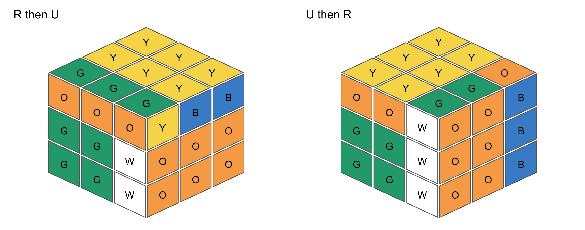
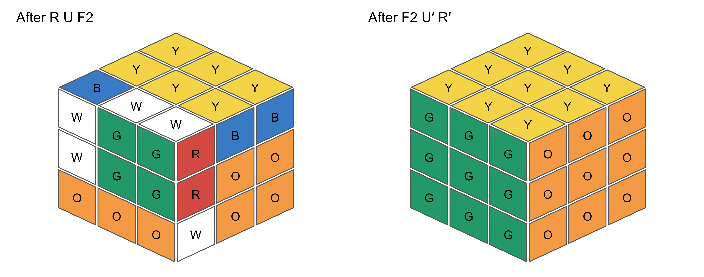
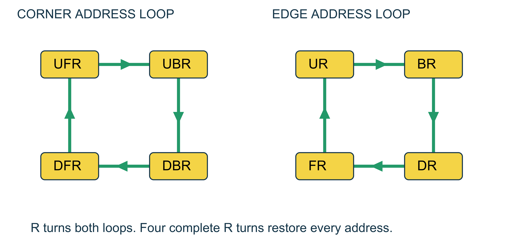
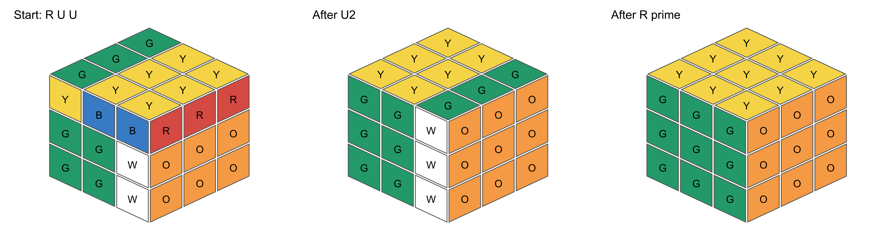
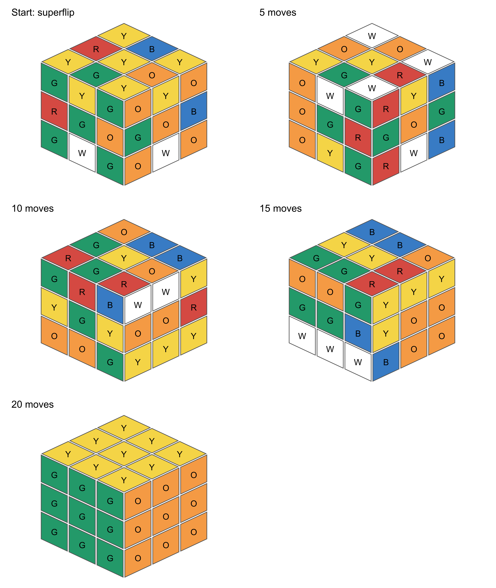

# Mathematics you can hold

> John Briggs · How to Master the Cube companion · Updated November 25, 2026. Optional learning beyond the book’s self-contained 3×3 courses. Model checks do not establish physical comfort or learner comprehension.

Begin with [notation and grip](notation.md). This lesson includes the experiments and their checks; no code or book is required.

## Begin with a small experiment

Mathematics can sound like something you must learn before you are allowed to enjoy a puzzle. Here you can begin with your hands. You already know enough notation for the first experiment. Have a solved cube ready, keep yellow up and green front, and turn slowly.

Do R followed by U. Look at the result, then undo it with U′ R′. Now do U followed by R. The same two faces moved, but the result differs. Finish by undoing the second experiment with R′ U′. You should be solved again.

A plain-language explanation is enough: the first move changes which pieces the second move picks up. Mathematicians call this failure to commute. The name describes the behavior you just observed. It does not add another move to memorize.

If a familiar routine stops working after you rearrange its moves, this experiment explains why. Having all the right letters is not enough. Their order belongs to the instruction. [S20]

## An inverse is a way back

Imagine carrying three boxes upstairs, then putting the last one inside a cupboard. To retrace your work, you must take that box out before carrying it downstairs. Undoing a sequence starts with its most recent action.

For a cube example, begin solved and do R U F2. Its inverse is F2 U′ R′. Reverse the order and reverse each turn; F2 remains F2 because another half turn undoes it. Execute that inverse and check every face.

Now cover the answer and write the inverse of L U2 F′. Say why each turn belongs where you put it. Answer: F U2 L′. Try the original followed by your answer on a solved cube. If the result is wrong, inspect your reversal before blaming the puzzle.

This is useful recovery knowledge. It works when you know the moves you actually made. It cannot recover an unknown history by wishful guessing. If you lose track, return to a visible checkpoint instead.

## A permutation is a rearrangement

Seat four people around a table and ask everyone to move one seat clockwise. The people remain themselves; their addresses change. A permutation is a precise description of that rearrangement. On a cube, we also need to describe which way each piece faces.

A corner can reach the correct address with the wrong sticker facing up. That is why these lessons keep asking two questions: is it home, and is it facing correctly? A picture of a white face alone cannot answer both.

A face turn moves four corners around a loop and four edges around another loop. Four repetitions of the same quarter turn return the original arrangement. Test R R R R. Count complete turns, not individual finger motions. Your first mathematical prediction is now something you can check directly.

## Some checks never change

An invariant is something that remains true while allowed actions take place. For an everyday example, rearranging chairs does not change how many chairs are in the room. On a cube, the useful checks are more subtle.

An otherwise solved 3×3 with just one edge flipped cannot be reached by ordinary face turns. Neither can an otherwise solved cube with just one corner twisted. Exchanging only two edges while leaving every other piece unchanged is also outside the legal 3×3 state set. These are consequences of the puzzle's movement rules, not evidence that you need a mysterious extra last step. The [computer-solving lesson](computer-solving.md#reject-bad-input-before-searching) explains the checks in more detail. [S20]

Do not create these demonstrations by twisting parts or forcing a mechanism. The lesson is to recognize the distinction. If a puzzle has come apart, been reassembled or had stickers moved, its starting state deserves checking before you keep searching for an ordinary-turn solution.

The rule belongs to the particular puzzle. A 2×2 has no edge pieces to constrain its corner permutation in the same way. A 4×4 has additional pieces and movements. An apparent exception on another puzzle should prompt you to examine its actual rules.

## Why the number gets so large

The standard 3×3 has 43,252,003,274,489,856,000 reachable positions when its center color frame is fixed. Reading that number aloud will not make you a better solver. Understanding why the count grows will. [S20]

Think of assigning eight corners to eight homes. There are eight choices for the first home, seven for the next, then six, continuing down to one. Multiplying those choices gives 8!, pronounced eight factorial. Each corner also has facing possibilities. Twelve edges add more choices of address and facing.

You cannot multiply all those possibilities without restrictions. The twist, flip and permutation checks rule out many arrangements. For readers who enjoy the arithmetic, the legal count is 8! × 3^7 × 12! × 2^10. The exponent means repeated multiplication: 3^7 means seven factors of three. You can leave the calculation here and still understand the lesson: independent choices grow rapidly, while movement rules limit which combinations are possible.

## Twenty moves does not mean twenty easy decisions

Suppose a map guarantees that any house in a town is within twenty junctions of the station. That does not tell you which junction to take when you leave a particular house. You still need directions.

The twenty-move result has a similar distinction. A half turn such as R2 counts as one move in that result. Under a rule that counts quarter turns individually, it counts as two. Always name the counting rule before comparing numbers. [S4]

A beginner method may take more moves because it offers recognizable stages and reliable checkpoints. A speed method may favor comfortable actions. A shortest-route search asks a different question. You can appreciate all three without mistaking one measure for the whole meaning of success.

## Finding Shorter Solutions: Think Before You Turn

You do not need racing fingers to start finding better routes. You need a small problem, a willingness to look and a way to check your idea. Start here with a solved cube, yellow up and green front. Keep that same grip throughout each example; turn faces, not the whole cube. A prime mark means turn counterclockwise when looking directly at that face. R2 means a half turn.

### A shortcut you can discover yourself

Scramble the solved cube with R U U. Three written turns have changed it. Before touching the cube again, ask: which action would undo the last two turns together?

U2 undoes U U, because two more quarter turns complete the upper face's full circle. Then R′ undoes the remaining right-face turn. Your solution is U2 R′: two moves in the half-turn metric. You could also use U′ U′ R′, which reaches exactly the same finish in three moves. Try both from the same starting position. Check all six faces, not just the face looking at you.

You discovered a route by asking what happened and what would undo it. That is a useful beginning. It is not a trick that finds the shortest solution to every scramble. On an unfamiliar position, you usually do not know its history.

### Efficiency and speed: two different wins

Efficiency is how much work you do. Speed is how quickly you finish. On the cube, we will measure efficiency by face-turn count and speed by elapsed time, including pauses.

Think of two routes to the grocery store. A shorter route with awkward junctions may take longer than a slightly longer route that flows smoothly. A shorter cube sequence can also be slower if you hesitate, change your grip repeatedly or struggle to recognize what comes next.

Our two-move example makes the counting distinction visible. U2 counts as one move here, even though your hand may perform it as two quarter turns. Under quarter-turn counting, both solutions use three moves. Reducing the written count does not automatically reduce physical effort or time.

Studying efficiency helps you notice unnecessary turns, repeated work and chances to solve pieces together. Practicing speed helps familiar actions become comfortable and reduces pauses. Both can build confidence. If your aim is a relaxed, reliable solve, a clear route you understand is already valuable. If your aim is a faster time, compare recognition and execution as well as move count.

### A real twenty-move exploration

Now meet the superflip. Every corner is correctly placed and facing the right way. Every edge is in its correct place but flipped. This is a legal position: twelve flipped edges obey the puzzle's rules, unlike a single flipped edge. Researchers established that the superflip needs twenty face turns in the half-turn metric. The following setup is published by the original twenty-move research team. [S4]

This is a guided exploration, not a test of whether you can invent an expert solution. You can follow and examine it without being a speedcuber. Return to a fully solved cube. Keep yellow up and green front. Apply these four groups in order; the separators are pauses, not extra moves.

| Setup group | Five moves |
|---|---|
| 1 | R L U2 F U′ |
| 2 | D F2 R2 B2 L |
| 3 | U2 F′ B′ U R2 |
| 4 | D F2 U R2 U |

Inspect all six faces. Each face should have its center and four corners in its own color; its four edge stickers should be the other color of each edge pair. On the front, for example, the green center and green corners remain, while none of the four edge stickers facing front is green. If that is not what you see, reset and repeat the setup slowly rather than forcing pieces into place.

Here is a verified solution for that exact setup. We found it by reversing the setup's order and reversing each turn. Half turns remain half turns. That gives us a reliable route to inspect; it does not teach us to discover an optimal route from any unknown scramble.

| Solution group | Five moves | Your checkpoint |
|---|---|---|
| 1 | U′ R2 U′ F2 D′ | Five moves completed; compare picture 2. |
| 2 | R2 U′ B F U2 | Ten moves completed; compare picture 3. |
| 3 | L′ B2 R2 F2 D′ | Fifteen moves completed; compare picture 4. |
| 4 | U F′ U2 L′ R′ | Twenty moves completed; every face solved. |

Follow one group at a time. Some correct corners will move away from home during the solution. That is allowed: a shortest route need not preserve the solved stages used by a beginner method. These groups are five-move reading chunks, not four separate solving stages. If a checkpoint differs, stop there. Check your grip, turn direction and last group before adding more moves. The final checkpoint is all six faces uniformly solved in the original center frame.

The published research establishes the twenty-move minimum for this position. Our exact sticker-model check verifies the setup's structure, every pictured checkpoint and the return to solved. Those are different kinds of evidence. This demonstration is not a new proof of the twenty-move theorem, nor a promise that people can readily find twenty-move solutions for arbitrary scrambles. [S4]

### Make the lesson yours

Set up R U U again. Before timing anything, practice U′ U′ R′ and U2 R′ until you can perform each comfortably. Then recreate the same starting position before every attempt. Record the route, half-turn move count and elapsed time separately. Include your pauses. Try each route three times; a single lucky attempt tells you little.

Which route used fewer counted moves? Which felt easier? Did it actually finish sooner? If the two-move route was slower, you have learned something about execution, not failed the exercise. Choose one thing to improve: recognizing the half turn, making it comfortably or avoiding a pause before R′. Do not rush past the final check.

For an independent challenge, start solved and apply F R R. Predict a two-move solution before trying it. Explain why it works and check every face. Answer: R2 F′. The repeated right turns combine into a half turn, then the front turn is undone. Next time you solve a larger scramble, look for one unnecessary move or one opportunity to preserve useful work. You do not have to reach twenty moves to begin thinking more clearly.

## Try, explain and transfer

First, predict whether R followed by R′ changes anything. Test it. Next, explain why swapping the two moves in R U can matter even though swapping the two moves in R R′ does not change the final result. Finally, choose a three-move sequence of your own, write its inverse and test the complete round trip.

A useful answer names the mechanism: R R′ cancel on the same layer; R and U overlap, so their order can change which pieces move next. Your own sequence should return every sticker when followed by its correctly constructed inverse. Repeat the task tomorrow without looking at today's answer.

You have just used prediction, observation, an explanation and an independent check. That is mathematical thinking. You can begin doing it long before you feel comfortable with mathematical vocabulary.

## Sources

[S20]: https://web.mit.edu/sp.268/www/rubik.pdf
[S4]: https://www.cube20.org/

[MIT’s Mathematics of the Rubik’s Cube](https://web.mit.edu/sp.268/www/rubik.pdf) provides group and legal-state background. The [original twenty-move research site](https://www.cube20.org/) supplies the diameter results and published superflip setup; this repository checks replay, not the theorem’s proof. See also [controlled changes and three-cycles](controlled-changes.md).
